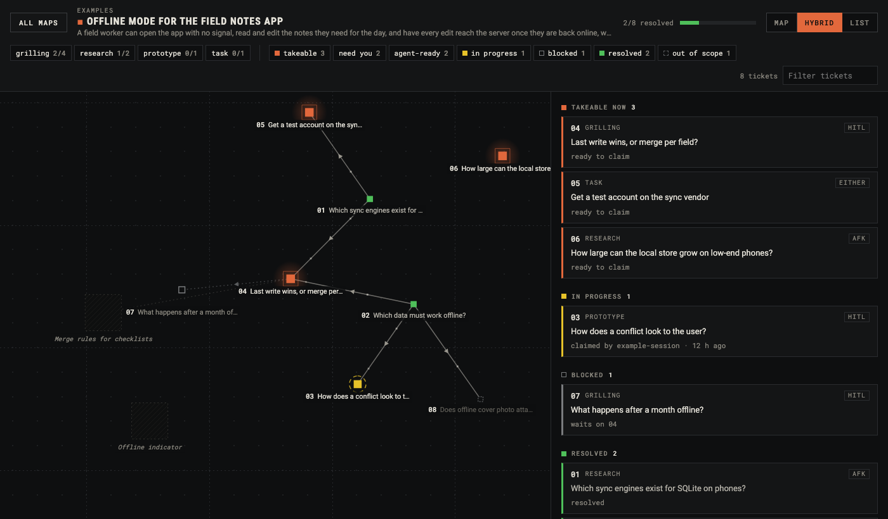

# wayfinder-maps

A read-only CLI and viewer for
[wayfinder](https://github.com/mattpocock/skills/tree/main/skills/engineering/wayfinder)
maps — the markdown planning memory an agent leaves under `.plan/<effort>/` as it charts
a large effort as a graph of investigation tickets. The wayfinder method and its skills
were created by [Matt Pocock](https://github.com/mattpocock); this repo adapts them and
adds the tooling.

- **`wayfinder-maps status <dir>`** — what is resolved, what is in flight, and what is ready
  to claim (the _frontier_: open, unclaimed, every blocker resolved).
- **`wayfinder-maps lint <dir>`** — does the map still tell the truth?
- **`wayfinder-maps serve` / `app`** — the map with ticket cards and filters, in a browser
  or a native window.
- **[`scripts/wayfinder-orca`](scripts/wayfinder-orca)** — the same viewer in a tab of
  [Orca](https://github.com/stablyai/orca)'s built-in browser. See
  [Wayfinder maps in Orca](#wayfinder-maps-in-orca) to set it up.
- **[`scripts/wayfinder-pull`](scripts/wayfinder-pull)** — a map kept as GitHub issues,
  mirrored into `.plan/` so the three commands above read it unchanged.

```
$ wayfinder-maps status ../expensif/.plan/daily-timeline
Daily Timeline — continuous days, empty days included
6 resolved · 0 claimed · 4 open · 0 out of scope

Frontier — ready to claim, first by number wins:
  05  Should HandleDaily's two branches converge      grilling
  06  Contain the day-card chrome drift               grilling
  07  The infinite-scroll island's contract           grilling
  10  Test strategy for the date-indexed timeline     grilling

Undermined — resolved on a premise that later changed:
  02  Window size and how older days load             broken by 08

Fog: 5 patches, 1 anchored to a ticket
```

## Wayfinder maps in Orca

`wayfinder-orca` opens a wayfinder map in a tab of Orca's built-in browser, beside the
agent working on it. Tested on macOS.

### Install

You need Orca and Homebrew. Setup takes about five minutes.

1. Install the tools. `gh` is only needed for maps kept as GitHub issues.

   ```
   brew install go jq gh
   gh auth login
   ```

2. Clone this repo and build the viewer. `go install` puts `wayfinder-maps` in
   `~/go/bin`; the launcher looks there, so it doesn't need to be on your PATH.

   ```
   git clone https://github.com/rengwu/wayfinder-maps.git ~/code/wayfinder-maps
   cd ~/code/wayfinder-maps
   go install ./cmd/wayfinder-maps
   ```

3. Put the launcher on your PATH.

   ```
   mkdir -p ~/.local/bin
   ln -s "$PWD/scripts/wayfinder-orca" ~/.local/bin/wayfinder-orca
   ```

   If a new terminal says `wayfinder-orca: command not found`, add
   `export PATH="$HOME/.local/bin:$PATH"` to `~/.zshrc` and open a new terminal.

4. Optional: install the Claude Code skill, so you can ask an agent to "show the
   wayfinder map".

   ```
   mkdir -p ~/.claude/skills
   ln -s "$PWD/skills/wayfinder-orca" ~/.claude/skills/wayfinder-orca
   ```

   Claude Code loads skills when a session starts, so start a new session after this.

### Try it

Open a terminal in any Orca worktree and run:

```
wayfinder-orca ~/code/wayfinder-maps/examples/.plan/offline-mode
```

A tab titled "wayfinder-maps" opens in that worktree's browser, showing the example map in
the screenshot above. The strip under the filters shows one lint warning, because the
example's claimed ticket is more than 72 hours old. That's expected.

Run it from an Orca terminal: the launcher calls the `orca` command, which Orca puts on the
PATH of its own terminals.

### Open your own maps

| Where the map lives | Command |
|---|---|
| A `.plan/` folder in the repo | `wayfinder-orca` from inside the repo (opens its list of maps) |
| One map folder | `wayfinder-orca path/to/.plan/<map>` |
| GitHub issues | `wayfinder-orca owner/repo#N`, where N is the map issue |

For a GitHub map, the launcher copies the map into `~/.cache/wayfinder-maps` with
[`wayfinder-pull`](scripts/wayfinder-pull) and opens the copy. Add `--every 120` to re-copy
it every two minutes so the tab follows the tracker; run the command again without
`--every` to stop that. To find the map issue, run `gh issue list -l wayfinder:map --state all`.

With the skill installed, you can instead ask Claude to "show the wayfinder map", and it
runs the right command.

### Using the page

- Three views: Map, Hybrid (map plus ticket cards) and List. Switch with the buttons at
  top right or the keys 1, 2 and 3. Below 760 px wide, Hybrid shows the cards alone.
- The chips filter by ticket type and by what can happen next: takeable, need you
  (HITL tickets), agent-ready (AFK tickets), in progress, blocked, resolved. Click a chip
  again to clear it.
- `/` focuses the search box, which matches ticket numbers, titles and text.
- Click a card or a ticket on the map to read the ticket. Escape closes it.
- The page redraws within two seconds of a ticket file changing on disk.

### Update

```
cd ~/code/wayfinder-maps
git pull
go install ./cmd/wayfinder-maps
pkill -f 'wayfinder-maps serve'
```

The next `wayfinder-orca` starts the new build. Reload any open map tabs.

### Troubleshooting

- `wayfinder-maps not found`: run `go install ./cmd/wayfinder-maps` in the clone.
- `the server on :7777 ignores ?path=`: an older build holds the port. Run
  `pkill -f 'wayfinder-maps serve'` and try again.
- Something else uses port 7777: run with another port, such as `PORT=7788 wayfinder-orca`.
- The tab opened in the wrong worktree: run the command from a terminal in the worktree you
  want, or set `ORCA_WORKTREE=path:/abs/path/to/repo`.
- The map tab looks frozen: Orca pauses tabs that aren't on screen. Click into the tab.
- The server log is at `$TMPDIR/wayfinder-maps-7777.log`.

## Install

### Skills, as a Claude Code plugin

```
/plugin marketplace add rengwu/wayfinder-maps
/plugin install wayfinder-maps@wayfinder-maps
```

`/wayfinder-maps` then works in every project; the map lands in that project's `.plan/`. The
plugin bundles `wayfinder-maps` plus the four skills it invokes by name — `grill-me`,
`research`, `prototype`, `domain-modeling`. All five were originally authored by Matt
Pocock in [mattpocock/skills](https://github.com/mattpocock/skills); the copies under
[`skills/`](skills/) are MIT-licensed adaptations.

### Skills, drop-in for any harness

Copy [`skills/`](skills/) into your project and tell your agent to read
`skills/wayfinder-maps/SKILL.md` and follow it; the skills it names live alongside.
You may include any of the extras under [`skills/.optional/`](skills/.optional/) too —
[`skills/README.md`](skills/README.md) describes the full set.

### The binary

- Download from [Releases](https://github.com/rengwu/wayfinder-maps/releases) — no Go
  toolchain needed, native window and folder dialog on all three platforms. macOS uses
  WKWebView (part of the OS); Windows uses WebView2 (ships with Windows 10/11); the
  Linux archive bundles a small helper that binds the system webkit —
  `libwebkit2gtk-4.1`, preinstalled on most desktops, one
  `sudo apt install libwebkit2gtk-4.1-0` otherwise. `status` and `lint` need nothing
  installed at all, even headless. The macOS and Linux archives also carry two
  double-clickable launchers — `wayfinder-app` opens the native window, `wayfinder-web`
  starts the server and opens your browser — no terminal needed (`.command` on macOS).
- `go install github.com/rengwu/wayfinder-maps/cmd/wayfinder-maps@latest`

Skill and binary are independent — each just reads the on-disk contract.

## Why

The map is shared memory: sessions orient to it before choosing work, and when it drifts
it lies to them silently. The skill makes most drift unrepresentable and verifies each
session's delta, no tool assumed. What a delta check cannot see is an edit made outside
the protocol, or two parallel sessions taking the same ticket number. `lint` is `fsck`
for those: it runs after the fact and re-establishes the base the next session rests on.

## The format contract

The contract is the skill's local-markdown adapter,
[`TRACKER-MARKDOWN.md`](skills/wayfinder-maps/TRACKER-MARKDOWN.md) — the skill itself is
tracker-agnostic method. This tool implements that adapter; any other reader should
target the same file. In summary: structure the facts, leave the prose alone. A ticket's
type and edges have exactly one correct value a machine can check. Its **Question** and
**Answer**, the map's **Destination** and **Notes**, and each one-line gist in
Decisions-so-far are lossy prose, never parsed.

A ticket is `.plan/<effort>/tickets/NN-<slug>.md`:

```markdown
---
type: research | prototype | grilling | task
blocked_by: [02, 03] # [] when none
claimed_by: <session id> # while a session holds it
claimed_at: 2026-07-10T09:00:00Z # RFC 3339, alongside claimed_by
undermined_by: [08] # optional — resolved on a premise 08 later broke
assets: [../assets/x.html.approved] # optional
---

# <Ticket title>

## Question

…

## Answer # its presence _is_ the resolution

…
```

### Status is derived

There is no `status:` field — every value it could hold is already written in the file,
and a second copy is free to go stale:

| Derived status | When                                                |
| -------------- | --------------------------------------------------- |
| `resolved`     | the body has an `## Answer` **with prose under it** |
| `out_of_scope` | the body has a `## Ruled out` with prose under it   |
| `claimed`      | neither, and `claimed_by` is set                    |
| `open`         | none of the above                                   |

Closure is read first, so a `claimed_by` left on a closed ticket is inert litter. And it
is the prose, not the heading, that closes a ticket: a session that types `## Answer` and
dies has resolved nothing — the ticket stays claimed, and its claim goes stale on
schedule. `lint` errors on the empty heading outright.

**`undermined_by`** marks a decision whose premise a later ticket broke; without it a
renderer paints the node green and launders a live problem into a checkmark.
**`claimed_at`** separates a dead session from live work. And `out_of_scope` stays
distinct from `resolved` — a scope boundary is not a step on the route, and a parser that
lumps them in over-counts.

### Fenced code blocks are not structure

Every scan — headings, titles, bullets, links — ignores what sits inside a ` ``` ` or
`~~~` fence. A ticket that quotes the ticket format contains the line `## Answer`, and
must not thereby resolve itself. The rule cuts one way only: an answer whose entire body
is a code fence is still an answer. Any other reader of these files owes the same rule.

### One session at a time

The adapter forbids concurrent sessions: git merges a duplicate ticket number cleanly and
neither session can see it. `lint` still reports duplicates, because a merge can happen
anyway.

Fog patches in the map's `## Not yet specified` are bullets with a bolded lead title and
an optional anchor; the rest stays loose prose:

```markdown
- **Today's row.** Whether today is visually distinguished. <clears-with: 04>
```

## Checks

Errors: dangling or self `blocked_by`; `blocked_by` cycles; duplicate ticket numbers; a
ticket carrying both `## Answer` and `## Ruled out`; a closing heading with nothing under
it; a resolved ticket missing from Decisions-so-far; an out-of-scope ticket listed as a
decision, or missing from Out-of-scope; Decisions-so-far pointing at an unresolved
ticket; a fog patch duplicating a live ticket's title, or anchored to a resolved ticket;
a missing Destination; an unknown type; a leftover `status:` field that disagrees with
the body.

Warnings: loose (pre-frontmatter) headers; a `status:` field that merely duplicates the
body; a claim with no owner or older than 72h; a claim left on a closed ticket; a ticket
blocked by something out of scope, which can never unblock.

Checks that need judgment — does a gist say what its answer says, does a fog title
duplicate a live ticket _in substance_ — stay with the skill; no parser can make them.

Exit `0` clean, `1` errors found, `2` no map at that path.

## Reading legacy maps

Two older shapes still parse, each lints as a warning, and neither is written any more:

- the loose header (`Type:` / `Status:` / `Blocked by:` after the H1), from before
  frontmatter;
- a stored `status:` field, from before status was derived. Where it agrees with the
  body, `lint` says to delete it; where it disagrees, that is an error and the body wins.

## Maps kept as GitHub issues

The wayfinder skill is tracker-agnostic: the same method can leave its map in an issue
tracker rather than in `.plan/`. [`scripts/wayfinder-pull`](scripts/wayfinder-pull) mirrors
such a map back into the local layout, so `status`, `lint` and the viewer read it with no
change to the reader — the tool still only knows about files.

```
scripts/wayfinder-pull <owner/repo> <map-issue-number> [out-dir]
```

It needs [`gh`](https://cli.github.com) (already logged in) and `jq`; there is no token to
configure. The default out-dir is `.plan/<slug of the map's title>`, wiped and rewritten on
each run — a cache, not a source, so nothing in it should be hand-edited and the directory
belongs in the host repo's `.gitignore`.

The mapping follows the GitHub adapter in the skill's setup notes. 
Two adjustments make the round trip parse. Headings inside a resolve comment are demoted one
level, since a comment opening with its own `##` would otherwise end the `## Answer` section
before any prose landed and leave the ticket unresolved. And the map body's ticket references
— issue URLs — are rewritten to `./tickets/NN-<slug>.md`, which is the only form
Decisions-so-far is scanned for; `## Decisions so far` and `## Out of scope` are generated
only when the map body carries no section of that name.

The mirror is one-directional and is a snapshot: claiming or resolving in the viewer changes
nothing in the tracker, and a change made there shows up on the next pull. `undermined_by`
has no GitHub representation, so a mirrored map never paints an undermined node.

## Build from source

```
go build ./cmd/wayfinder-maps      # pure Go: status, lint, serve
go test ./...
```

The native window needs cgo on macOS (WKWebView); Windows is pure Go (WebView2). On
Linux the webkit linkage lives in a separate helper, `./cmd/wayfinder-maps-webview`,
built with `libwebkit2gtk-4.1-dev` and kept next to the main binary. Releases are cut
by tagging `v*` — CI builds the helper on Linux runners and GoReleaser packs everything.
